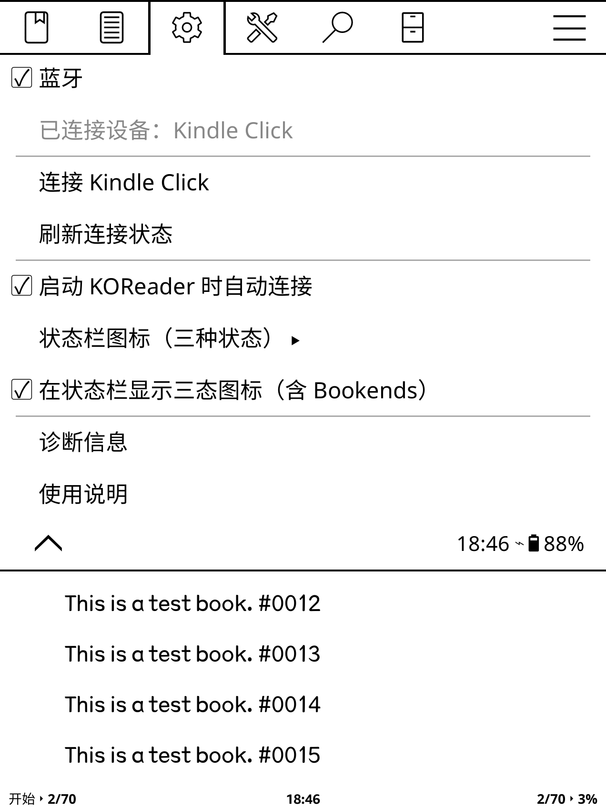
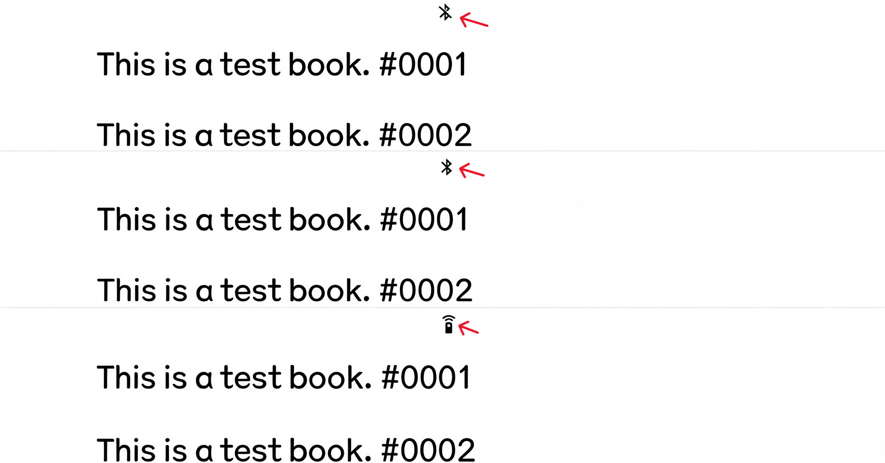
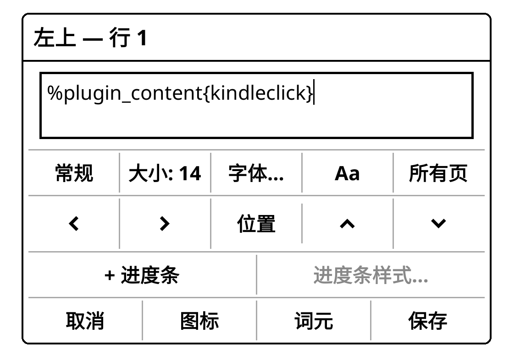

# Kindle Click 蓝牙 / Kindle Click Bluetooth

[中文说明](#中文说明) | [English](#english)

---

## 中文说明

仅用于 **Kindle** 的独立 KOReader 插件。控制原生蓝牙、识别 Kindle Click、补充翻页键映射，并在菜单、KOReader 阅读状态栏或 Bookends 中显示状态。

### 功能

- 在 **设置 → 网络 → Kindle Click** 中加入蓝牙开关。
- 显示当前蓝牙连接的设备名称。
- 启动 KOReader 或唤醒时检查原生蓝牙状态；如果睡前确认蓝牙开启，唤醒后会有限重试恢复（自动连接 Click 可单独关闭）。
- 按电源键或 Click 双侧键进入休眠时主动断开并释放 Click；重新开启蓝牙前清理残留会话。
- 提供“连接 Kindle Click”“刷新连接状态”和“诊断信息”菜单项。
- 长按“Kindle Click”上一级菜单项，可以直接开关蓝牙。
- 三种状态共用**同一个图标位**，不再用有无图标表示开关：
  - 蓝牙关闭：默认显示“蓝牙关闭”图标。
  - 蓝牙已开启但未连接 Kindle Click：默认显示“蓝牙”图标。
  - 已连接 Kindle Click：默认显示“遥控器”图标。
- 三种状态可分别选择图标。预设及自定义码位均使用 KOReader 自带的 `nerdfonts/symbols.ttf`；也可输入其他 Unicode 符号码位。
- 提供“开/关蓝牙”和“连接”两个动作，可在 KOReader 手势管理中绑定。
- 为触屏版 Kindle 补充 `KEY_PAGEUP` / `KEY_PAGEDOWN` 翻页映射，不启用整套外接键盘文本输入。

### 截图

**菜单与蓝牙控制**



**三种连接状态共用同一个图标位**



**在 Bookends 中配置状态显示**



### 安装或升级

1. 先在 Kindle 原生系统中完成 Kindle Click 配对。本插件不扫描和配对设备。
2. 升级旧版时，先删除旧的 `kindleclick.koplugin` 文件夹，再将新版完整复制到：

   ```text
   /mnt/us/koreader/plugins/kindleclick.koplugin
   ```

3. 完全退出并重新启动 KOReader，使翻页映射和当前书籍的按键注册重新加载。
4. 打开顶部菜单，进入 **设置 → 网络 → Kindle Click**。

### 自定义状态栏图标

进入 **Kindle Click → 状态栏图标（三种状态）**，分别设置“蓝牙关闭”“蓝牙开启，Click 未连接”“Kindle Click 已连接”。

每个状态都有预设图标和“自定义 Unicode 码位”。例如 `U+E7B1` 是蓝牙关闭、`U+E7AE` 是蓝牙、`U+EB53` 是遥控器。自定义输入支持 `U+EB53`、`0xEB53` 或 `EB53` 三种写法。若所选字形不在字体中，可能显示为空框。

“在状态栏显示三态图标（含 Bookends）”是本插件的总开关；关闭后会同时从原生状态栏和 Bookends 移除本插件内容。

### 在 Bookends 中显示

不需要修改 Bookends 源文件。Bookends 会直接读取本插件注册到 KOReader 的状态栏内容，即使 KOReader 自带状态栏已关闭也可以显示。

在 Bookends 希望显示图标的任意一行格式中加入：

```text
%plugin_content{kindleclick}
```

花括号过滤表示只显示本插件，不会混入阅读计时器等其他插件的内容。使用不带过滤条件的 `%plugin_content` 则会聚合所有已注册插件。状态或图标改变时，本插件会发送 Bookends 已支持的 `RefreshAdditionalContent` 事件，无需另装补丁。如果当前 Bookends 不认识 `%plugin_content`，请先升级 Bookends。

### Click 五个按键功能

| 操作 | 按键码 | 5.20.1 上的处理路径 |
|---|---:|---|
| 上方面键：向前翻页 | `KEY_PAGEDOWN` 109 | 原生转发到 `kindle-input-pt`，本插件补充 KOReader 映射 |
| 下方面键：向后翻页 | `KEY_PAGEUP` 104 | 原生转发到 `kindle-input-pt`，本插件补充 KOReader 映射 |
| 上侧键：亮度增加 | `KEY_BRIGHTNESSUP` 225 | 已测试固件中由 Kindle 原生按键处理；插件不重复映射 |
| 下侧键：亮度减少 | `KEY_BRIGHTNESSDOWN` 224 | 已测试固件中由 Kindle 原生按键处理；插件不重复映射 |
| 同时长按两侧键：休眠 | `KEY_POWER` 116 | 已测试固件中由原生系统处理；插件不重复执行休眠 |

既有 KPW6 测试观察到亮度键长按重复调节及双侧键休眠；这些是设备观察，不是公开固件规范。Click 不能唤醒设备。上述三个非翻页动作由已测试固件的原生系统处理，**本插件不会再执行一次**，以免重复触发。

### Kindle 5.20.1 / KPW6 说明

- 本项目在 KPW6 / 5.20.1 的输入节点观察到 **VID:PID `0171:0443`**。插件用 `/proc/bus/input/devices` 中匹配的活动节点判断连接；这是该设备观察，不代表所有固件的官方产品标识。
- 在该设备观察中，系统保存的底层名称可能是“Amazon Fire TV Remote”，插件仍按输入节点标识显示“Kindle Click”。
- 本项目观察到的 `kindle-input-pt` 是原生转发节点，**它的存在不代表 Click 已连接**，插件不会用它伪造连接状态；其他固件版本仍需确认。
- 既有 KPW6 / 5.20.1 设备观察到原生系统可重连 Click；公开资料未说明其内部机制。“连接 Kindle Click”会确保蓝牙开启并做有限次状态确认；请按一下 Click 并等待数秒。若曾在原生设置中手动断开，可能仍需在原生的“蓝牙设备”页面点一次“连接”。
- 插件只添加 PageUp/PageDown 两个加法式映射，并刷新当前书籍的翻页键注册；不打开或 `EVIOCGRAB` 抢占原始 Click 节点，不重复转发事件，也无需同时启用 ExternalKeyboard。
- 在已测试的 KPW6 上，原生输入管线已处理方向切换；插件避免 KOReader 对 `kindle-input-pt` 再做一次方向交换。其他固件版本仍需验证。

### 低功耗设计

- 没有常驻轮询，没有后台守护进程，也不会阻止 Kindle 休眠。
- 状态只在启动、唤醒、菜单访问、状态栏本来就要刷新、设备热插拔或手动操作时读取。
- 菜单和状态栏触发的状态读取至少有 30 秒间隔，且仅在已有界面活动时执行。
- 唤醒恢复最多重发 3 次原生“开启”请求；每次间隔数秒，无常驻轮询。若 `btfd` 状态不可读取，不会把未知状态伪装成关闭。
- 发起连接后仅在第 2、5、10、20 秒做有限次状态确认；若仍未检测到 Click，会报告连接未确认，不再保留定时器。
- 图标选择只读写 KOReader 设置并触发一次界面刷新，不增加定时器或字体扫描。
- 诊断信息仅在手动打开时采集，不启动扫描或监听。
- 退出 KOReader 时不会擅自关闭蓝牙；如需省电，可在菜单中手动关闭。

如果 Click 在静止阅读期间自行断开，图标会在下一次状态栏活动、唤醒或打开菜单时更新，而不是依靠高频后台查询保持实时。

### 深度休眠恢复边界与公开证据

KOReader 的 `onSuspend` / `onResume` 生命周期钩子适合在设备休眠前后处理状态（参见 [KOReader 网络监听器](https://github.com/koreader/koreader/blob/9040116701c888889bd35233b23b83283be66745/frontend/ui/network/networklistener.lua)）。公开的 [KindleModding btfd 属性表](https://github.com/KindleModding/kindlemodding.github.io/blob/b3f5456afb18a8a054b03231e6ee3dc4c78172b2/content/kindle-apps-and-services/com.lab126.btfd.md)列出了 `BTstate`、`BTenable`、`BTflightMode`、`Connect` 和 `Disconnect`，但其具体描述仍标为 TODO。另一个 KOReader 插件 [Moon Kindle 蓝牙后端](https://github.com/AnkioTomas/moon/blob/a462eb25590a624048738799f37b518da81cbfb7/book.koplugin/features/bluetooth/kindle.lua)也通过 `com.lab126.btfd`/LIPC 工作；其[异步封装](https://github.com/AnkioTomas/moon/blob/a462eb25590a624048738799f37b518da81cbfb7/book.koplugin/features/bluetooth/sync.lua)在发出原生请求后做有限状态等待。本插件借鉴了“请求后验证、有限重试”的模式；这些独立实现都不是 Amazon 固件规范。

因此本插件只在已确认睡前蓝牙开启（或用户启用了启动自动连接）时，经 Kindle 原生 LIPC 接口有限重发开启请求，并重新读取 `BTstate`；失败会提示查看诊断。若 LIPC 状态读取失败，界面显示“未知”而非“关闭”。插件不会杀死/重启 `btfd`、`input_manager`，不会操作内核电源/射频接口，也不会改动配对数据。公开资料无法证明 KPW6 5.20.1.0.2 深度睡眠后的底层故障究竟位于服务、固件、控制器还是电源状态；也没有找到可公开验证的 Amazon 资料说明五个按键在该固件中的内部路由。按键表属于本项目既有 KPW6 设备观察，不应视作固件规范。如果原生服务或控制器本身卡死，KOReader 插件无法安全保证恢复，仍需设备端诊断与实测。

### 诊断与故障排查

1. 保持 Click 在原生系统中已配对，进入 KOReader 后按一下 Click。
2. 打开 **Kindle Click → 诊断信息**。
3. 诊断会同时显示并保存到：

   ```text
   /mnt/us/koreader/kindleclick-diagnostic.txt
   ```

4. 若仍显示“已连接设备：无”、无法翻页，或亮度/休眠侧键无效，请提供该文件。诊断包含输入节点、相关进程和 LIPC 属性，但不读取或导出蓝牙 LinkKey。

**公开分享诊断文件前请先检查并遮盖蓝牙地址等隐私信息。**

仅支持 Kindle，不适用于 Kobo、Android 或桌面版 KOReader。建议使用当前 KOReader 版本。1.2.0 的连接、翻页、侧键、三态图标和 Bookends 显示已通过 KPW6 / 5.20.1 实机确认；1.2.1 仅移除 `_meta.lua` 中已弃用的 `name` 字段。1.2.2 新增休眠前主动释放 Click 及开启蓝牙前清理残留会话。1.2.3 完善新旧 btfd 开关指令兼容，并增加睡前状态快照。1.2.4 将 LIPC 状态读取失败与蓝牙关闭区分，并在获准恢复时进行有限唤醒重试、显示失败提示。1.2.2–1.2.4 的代码路径可做静态/逻辑验证；1.2.4 的深度休眠恢复仍需在目标 KPW6 固件上实测。

### 文件

```text
kindleclick.koplugin/
├── _meta.lua
├── kindleclick_bluetooth.lua    # 蓝牙状态、原生 Click 识别与旧版连接回退
├── kindleclick_diagnostics.lua  # 手动触发的只读诊断
├── kindleclick_icons.lua        # 三态图标、预设及自定义 Unicode 码位
├── main.lua                     # 菜单、状态栏、翻页映射和有限状态确认
└── README.md
```

### 开发回归测试

在仓库根目录使用 Lua 5.1 兼容解释器运行：

```sh
lua tests/kindleclick_bluetooth_spec.lua
lua tests/kindleclick_recovery_spec.lua
```

### Development regression tests

Run from the repository root with a Lua 5.1-compatible interpreter:

```sh
lua tests/kindleclick_bluetooth_spec.lua
lua tests/kindleclick_recovery_spec.lua
```

---

## English

A standalone KOReader plugin for **Kindle** only. It controls Kindle's native Bluetooth, detects the Kindle Click, adds the missing page-turn mappings, and reports connection status in the menu, KOReader's reading footer, or Bookends.

### Features

- Adds a Bluetooth switch under **Settings → Network → Kindle Click**.
- Shows the name of the currently connected Bluetooth device.
- Checks native Bluetooth on startup/resume and makes bounded wake-recovery attempts if Bluetooth was confirmed on before sleep; Click auto-connect is independently configurable.
- Cleanly disconnects and releases the Click when the power button or the Click's sleep gesture enters sleep, and clears a stale session before re-enabling Bluetooth.
- Provides **Connect Kindle Click**, **Refresh connection status**, and **Diagnostics** menu items.
- Long-press the parent **Kindle Click** menu item to toggle Bluetooth directly.
- Uses **one icon position for all three states**, rather than showing or hiding an icon:
  - Bluetooth off: Bluetooth-off icon by default.
  - Bluetooth on, but Kindle Click not connected: Bluetooth icon by default.
  - Kindle Click connected: remote-control icon by default.
- Allows a separate icon for each state. Presets and custom codepoints use KOReader's bundled `nerdfonts/symbols.ttf`; other Unicode symbol codepoints are also accepted.
- Provides **Toggle Bluetooth** and **Connect** actions that can be assigned in KOReader's gesture manager.
- Adds `KEY_PAGEUP` / `KEY_PAGEDOWN` page-turn mappings for touch-only Kindles without enabling the full external-keyboard text-input mode.

### Screenshots

**Menu and Bluetooth controls**


**Three connection states sharing one icon position**


**Configuring the status display in Bookends**


### Installation and upgrades

1. Pair the Kindle Click in Kindle's native settings first. This plugin does not scan for or pair devices.
2. When upgrading, delete the old `kindleclick.koplugin` folder before copying the complete new folder to:

   ```text
   /mnt/us/koreader/plugins/kindleclick.koplugin
   ```

3. Fully exit and restart KOReader so that the page-turn mappings and the current book's key registrations are reloaded.
4. Open the top menu and go to **Settings → Network → Kindle Click**.

### Customizing the status icons

Go to **Kindle Click → Status icons (three states)** and configure **Bluetooth off**, **Bluetooth on, Click not connected**, and **Kindle Click connected** separately.

Each state offers preset icons and a **Custom Unicode codepoint** option. For example, `U+E7B1` is Bluetooth off, `U+E7AE` is Bluetooth, and `U+EB53` is a remote control. Custom input accepts `U+EB53`, `0xEB53`, or `EB53`. A glyph missing from the selected font may appear as an empty box.

**Show three-state icons in the status bar (including Bookends)** is the plugin's display switch. Turning it off removes this plugin's content from both KOReader's stock footer and Bookends.

### Displaying the status in Bookends

No changes to Bookends' source files are required. Bookends reads the content that this plugin registers with KOReader's footer extension API, even when KOReader's own status bar is disabled.

Add the following to any Bookends line where the icon should appear:

```text
%plugin_content{kindleclick}
```

The brace filter selects only this plugin, excluding content from other plugins such as reading timers. The unfiltered `%plugin_content` token aggregates content from all registered plugins. When the status or icon changes, this plugin emits the `RefreshAdditionalContent` event already supported by Bookends; no additional patch is needed. If your Bookends version does not recognize `%plugin_content`, upgrade Bookends first.

### Click button functions

| Action | Key code | Handling path on firmware 5.20.1 |
|---|---:|---|
| Upper face button: page forward | `KEY_PAGEDOWN` 109 | Forwarded by the native system through `kindle-input-pt`; this plugin adds the KOReader mapping |
| Lower face button: page back | `KEY_PAGEUP` 104 | Forwarded by the native system through `kindle-input-pt`; this plugin adds the KOReader mapping |
| Upper side button: brightness up | `KEY_BRIGHTNESSUP` 225 | Handled by Kindle's native input path in the tested firmware; this plugin does not remap it |
| Lower side button: brightness down | `KEY_BRIGHTNESSDOWN` 224 | Handled by Kindle's native input path in the tested firmware; this plugin does not remap it |
| Long-press both side buttons: sleep | `KEY_POWER` 116 | Handled by the native system in the tested firmware; this plugin does not duplicate sleep |

Existing KPW6 tests observed repeat brightness adjustment and the two-button sleep gesture; these are observations, not a published firmware specification. The Click cannot wake the device. The three non-page-turn actions are handled by the native path in the tested firmware and **are not executed again by this plugin**, avoiding duplicate actions.

### Notes for Kindle 5.20.1 / KPW6

- This project observed **VID:PID `0171:0443`** on the KPW6 / 5.20.1 input node. The plugin matches the active node in `/proc/bus/input/devices`; this device observation is not an official product identifier for all firmware.
- On the tested device, the system sometimes stored the underlying name as “Amazon Fire TV Remote.” The plugin uses the observed input identifier and displays “Kindle Click.”
- In this project's tested setup, `kindle-input-pt` is a native pass-through device. **Its presence does not mean that a Click is connected**, and the plugin never uses it to fabricate a connected state; other firmware versions should be checked.
- Existing KPW6 / 5.20.1 device observations report native Click reconnection; the public sources below do not specify its internal mechanism. **Connect Kindle Click** ensures that Bluetooth is enabled and performs a bounded series of status checks. Press the Click once and wait a few seconds. If it was manually disconnected in the native settings, you may still need to tap **Connect** once on Kindle's native **Bluetooth devices** page.
- The plugin only adds the PageUp/PageDown mappings and refreshes the current book's key registrations. It does not open or `EVIOCGRAB`-grab the raw Click device, duplicate event forwarding, or require ExternalKeyboard.
- On the tested KPW6, the native input pipeline handles orientation changes. The plugin prevents KOReader from applying a second orientation swap to `kindle-input-pt`; other firmware versions should be checked.

### Low-power design

- No persistent polling, no background daemon, and no interference with Kindle sleep.
- Status is read only at startup, resume, menu access, an already-occurring footer redraw, input-device hotplug, or a manual action.
- Menu- and footer-triggered status reads are at least 30 seconds apart and run only when there is already UI activity.
- Wake recovery reissues the native enable request at most three times, a few seconds apart, with no persistent polling. An unreadable `btfd` state is shown as unknown (`?`) rather than off.
- After initiating a connection, status checks occur only at 2, 5, 10, and 20 seconds. If Click is still not detected, the plugin reports that connection was not confirmed; no timer remains after success or the final check.
- Icon selection only reads or writes KOReader settings and triggers one UI refresh; it adds no timer or font scanning.
- Diagnostics are collected only when explicitly opened and do not start scanning or listening.
- Exiting KOReader does not turn off Bluetooth without permission. Turn Bluetooth off manually when needed to save power.

If the Click disconnects while you are reading without interacting with the device, the icon updates on the next status-bar activity, resume, or menu visit rather than relying on high-frequency background queries.

### Deep-sleep recovery boundaries and public evidence

KOReader's `onSuspend` / `onResume` lifecycle hooks are used by its [network listener](https://github.com/koreader/koreader/blob/9040116701c888889bd35233b23b83283be66745/frontend/ui/network/networklistener.lua) to manage state around sleep. The public [KindleModding btfd property table](https://github.com/KindleModding/kindlemodding.github.io/blob/b3f5456afb18a8a054b03231e6ee3dc4c78172b2/content/kindle-apps-and-services/com.lab126.btfd.md) lists `BTstate`, `BTenable`, `BTflightMode`, `Connect`, and `Disconnect`, but leaves their detailed descriptions as TODO. The independent KOReader plugin [Moon's Kindle Bluetooth backend](https://github.com/AnkioTomas/moon/blob/a462eb25590a624048738799f37b518da81cbfb7/book.koplugin/features/bluetooth/kindle.lua) also uses `com.lab126.btfd`/LIPC; its [async wrapper](https://github.com/AnkioTomas/moon/blob/a462eb25590a624048738799f37b518da81cbfb7/book.koplugin/features/bluetooth/sync.lua) performs bounded status waiting after native requests. This plugin borrows the request-then-verify, bounded-retry pattern; neither project is an Amazon firmware specification.

Accordingly, this plugin only reissues the native LIPC enable request a bounded number of times when Bluetooth was confirmed on before sleep (or startup auto-connect was enabled), and then rereads `BTstate`; failure is reported with a prompt to inspect diagnostics. An unreadable LIPC state is shown as unknown (`?` in the footer and an explicit unknown label in the menu), not off. The plugin does not kill/restart `btfd` or `input_manager`, manipulate kernel radio/power controls, or modify pairing data. Public evidence does not establish whether the underlying deep-sleep failure on KPW6 firmware 5.20.1.0.2 is in the service, firmware, controller, or power state; no public Amazon source was found documenting the internal routing of all five buttons on this firmware either. The button table reflects existing project/device observations, not a firmware specification. If the native service or controller is wedged, a KOReader plugin cannot safely guarantee recovery; device diagnostics and testing remain necessary.

### Diagnostics and troubleshooting

1. Keep the Click paired in Kindle's native settings, enter KOReader, and press the Click once.
2. Open **Kindle Click → Diagnostics**.
3. The diagnostic report is displayed and saved to:

   ```text
   /mnt/us/koreader/kindleclick-diagnostic.txt
   ```

4. If the plugin still shows “Connected device: None,” page turning does not work, or the brightness/sleep side buttons are unresponsive, provide this file. Diagnostics include input devices, relevant processes, and LIPC properties, but do not read or export Bluetooth LinkKeys.

**Before sharing a diagnostic report publicly, review it and redact private information such as Bluetooth addresses.**

Kindle only; Kobo, Android, and desktop KOReader are not supported. A current KOReader version is recommended. Version 1.2.0 was verified on KPW6 / firmware 5.20.1 for connection, page turning, side buttons, three-state icons, and Bookends display. Version 1.2.1 only removes the deprecated `name` field from `_meta.lua`. Version 1.2.2 releases the Click before sleep and clears stale sessions before enabling Bluetooth. Version 1.2.3 adds new/old btfd command compatibility and a pre-sleep state snapshot. Version 1.2.4 distinguishes unreadable LIPC status from Bluetooth-off and adds bounded wake retries and failure reporting when restoration is authorized. The 1.2.4 recovery behavior still requires on-device verification on the target KPW6 firmware.

### Files

```text
kindleclick.koplugin/
├── _meta.lua
├── kindleclick_bluetooth.lua    # Bluetooth status, native Click detection, and legacy connection fallback
├── kindleclick_diagnostics.lua  # Read-only diagnostics triggered manually
├── kindleclick_icons.lua        # Three-state icons, presets, and custom Unicode codepoints
├── main.lua                     # Menu, footer status, page-turn mappings, and bounded status checks
└── README.md
```
